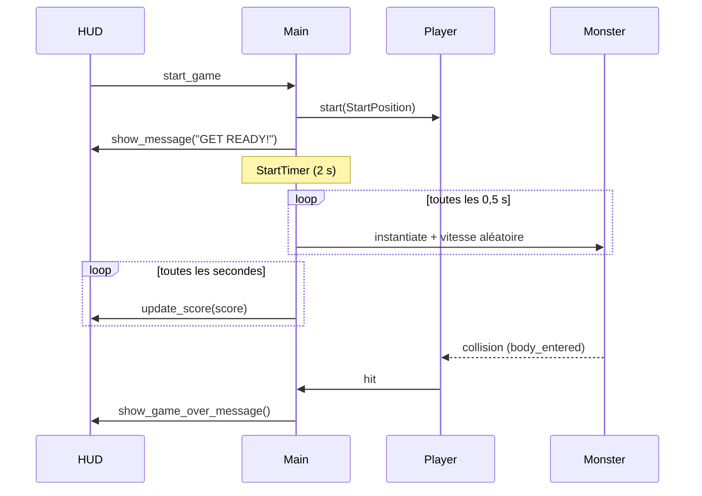

# Petit jeu tutorial

Jeu d'esquive 2D réalisé avec Godot 4 en suivant la série « Créer son premier jeu vidéo facilement sur Godot » de TUTO UNITY FR. Le joueur se déplace sur l'écran et doit éviter des monstres qui le traversent ; chaque seconde de survie rapporte un point.

## Fonctionnel

### Déroulement d'une partie

1. L'écran d'accueil affiche le score, le message « Dodge the enemies! » et un bouton **Start**.
2. Un clic sur **Start** lance la musique, place le joueur au centre-bas de l'écran et affiche « GET READY! ».
3. Après 2 secondes, les monstres commencent à apparaître (un toutes les 0,5 s) et le score augmente d'un point par seconde.
4. Au premier contact avec un monstre : la musique s'arrête, un son de game over est joué, « GAME OVER! » s'affiche, puis le bouton **Start** réapparaît pour rejouer.

### Contrôles

| Action | Touche |
|---|---|
| Se déplacer | Flèches du clavier (haut, bas, gauche, droite) |
| Lancer / relancer une partie | Bouton **Start** (souris ou toucher) |

Le joueur ne peut pas sortir de l'écran.

### Monstres

Trois types, choisis au hasard à chaque apparition : `ghost`, `skeleton`, `slime`. Ils naissent sur un point aléatoire du bord de l'écran, partent vers l'intérieur à une vitesse comprise entre 150 et 250 px/s, et sont supprimés dès qu'ils quittent l'écran.

## Technique

### Stack

- **Moteur** : Godot 4.7, rendu Forward+
- **Langage** : GDScript
- **Exports configurés** : Web (HTML5) et macOS

### Format d'écran

Le jeu est pensé pour un smartphone Android en portrait, sur la base d'un Samsung Galaxy A52s (1080 x 2400, ratio 20:9).

| Paramètre (`project.godot`) | Valeur | Rôle |
|---|---|---|
| `window/size/viewport_width` / `viewport_height` | 1080 x 2400 | Résolution de référence du jeu |
| `window/size/window_*_override` | 432 x 960 | Taille de la fenêtre sur ordinateur, pour tenir sur un écran de bureau |
| `window/handheld/orientation` | 1 (portrait) | Orientation forcée sur mobile |
| `window/stretch/mode` | `canvas_items` | Mise à l'échelle de l'affichage selon la taille réelle de l'écran |
| `window/stretch/aspect` | `expand` | Remplit l'écran sur les téléphones d'un autre ratio |

Le chemin d'apparition des monstres (`MonsterPath`) suit le contour 1080 x 2400 ; si la résolution de référence change, il faut le redessiner dans `main.tscn`.

### Arborescence

```
.
├── project.godot                 # Configuration du projet (écran, entrées, scène principale)
├── export_presets.cfg            # Préréglages d'export Web et macOS
├── icon.svg
└── creer-un-jeu-sur-godot-facilement-assets-main/
    ├── scenes/
    │   ├── main.tscn             # Scène racine : assemble joueur, HUD, timers, musique
    │   ├── player.tscn           # Joueur (Area2D)
    │   ├── monsters.tscn         # Monstre (RigidBody2D)
    │   └── hud.tscn              # Interface (CanvasLayer)
    ├── scripts/
    │   ├── main.gd               # Boucle de jeu : score, apparition des monstres, game over
    │   ├── player.gd             # Déplacement, collision, signal hit
    │   ├── monsters.gd           # Animation aléatoire, suppression hors écran
    │   └── hud.gd                # Messages, score, bouton Start
    ├── art/                      # Sprites, musique, son de game over
    ├── fonts/Pixeled.ttf         # Police pixel
    └── builds/                   # Sortie de l'export Web (ignorée par git)
```

### Composants

| Scène | Nœud racine | Responsabilité |
|---|---|---|
| `main.tscn` | `Node` | Orchestre la partie. Possède les timers `StartTimer` (2 s, une fois), `ScoreTimer` (1 s) et `MonsterTimer` (0,5 s), le chemin `MonsterPath`, le marqueur `StartPosition` et les lecteurs audio. |
| `player.tscn` | `Area2D` | Lit les actions `move_*`, déplace le joueur à 400 px/s, le borne à l'écran. Émet `hit` au contact d'un corps et désactive sa collision. |
| `monsters.tscn` | `RigidBody2D` | Sans gravité, `collision_mask = 0` (les monstres ne se heurtent pas entre eux). Joue une animation au hasard ; `VisibleOnScreenNotifier2D` le libère en sortie d'écran. |
| `hud.tscn` | `CanvasLayer` | Affiche score et messages, émet `start_game` au clic sur Start. |

### Flux des signaux



### Entrées

Les actions `move_left`, `move_right`, `move_up` et `move_down` sont déclarées dans `project.godot` et liées aux flèches du clavier. `player.gd` les combine avec `Input.get_vector`, ce qui normalise la vitesse en diagonale.

## Lancer le projet

1. Installer [Godot 4.7](https://godotengine.org/download).
2. Ouvrir Godot, **Importer** puis sélectionner `project.godot`.
3. Appuyer sur **F5** pour lancer la scène principale.

En ligne de commande (macOS) :

```bash
/Applications/Godot.app/Contents/MacOS/Godot --path .
```

## Exporter

Les préréglages sont dans `export_presets.cfg` :

- **Web** : génère `creer-un-jeu-sur-godot-facilement-assets-main/builds/Petit_jeu_tutorial.html` (servir le dossier via un serveur HTTP, pas en `file://`).
- **macOS** : chemin de sortie à choisir au moment de l'export.

Menu **Projet > Exporter**, choisir le préréglage puis **Exporter le projet**. Les modèles d'export Godot doivent être installés.

## Limites connues

- **Pas de contrôle tactile** : le déplacement ne se fait qu'au clavier. Sur téléphone, le bouton Start répond au toucher mais le joueur ne peut pas bouger.
- **Pas de préréglage d'export Android** : à ajouter (SDK Android et keystore requis) pour installer le jeu sur le téléphone.
- **Monstres jamais nettoyés au game over** : ceux encore à l'écran continuent leur trajet après la fin de la partie.

## Crédits

- Assets et série de tutoriels : [TUTO UNITY FR](https://www.youtube.com/c/tutounityfr), voir `creer-un-jeu-sur-godot-facilement-assets-main/README.md` et `LICENSE`.
- Musique « House In a Forest Loop » : HorrorPen.
- Police : Pixeled.
