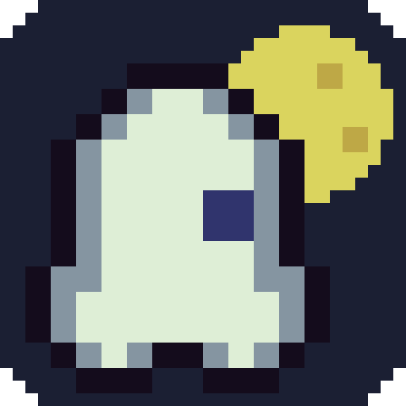
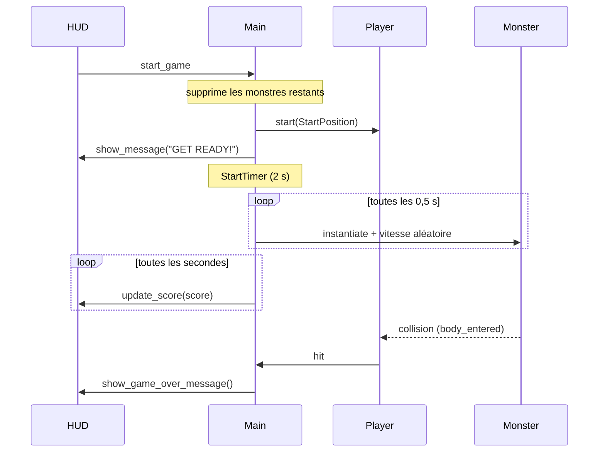

# Petit jeu tutorial



Jeu d'esquive 2D réalisé avec Godot 4 en suivant la série « Créer son premier jeu vidéo facilement sur Godot » de TUTO UNITY FR. Le joueur se déplace sur l'écran et doit éviter des monstres qui le traversent ; chaque seconde de survie rapporte un point.

## Fonctionnel

### Déroulement d'une partie

1. L'écran titre affiche le logo (qui flotte doucement), le score, le message « Dodge the enemies! » et un bouton **Start**.
2. Un clic sur **Start** supprime les monstres restants de la partie précédente, lance la musique, place le joueur au centre-bas de l'écran et affiche « GET READY! ».
3. Après 2 secondes, les monstres commencent à apparaître (un toutes les 0,5 s) et le score augmente d'un point par seconde.
4. Au premier contact avec un monstre : la musique s'arrête, un son de game over est joué, « GAME OVER! » s'affiche, puis l'écran titre (logo et bouton **Start**) réapparaît pour rejouer. Les monstres déjà à l'écran finissent leur trajet en fond jusqu'au prochain **Start**.

### Contrôles

| Action | Touche |
|---|---|
| Se déplacer (clavier) | Flèches (haut, bas, gauche, droite) |
| Se déplacer (tactile) | Garder le doigt appuyé : le joueur se dirige vers lui |
| Lancer / relancer une partie | Bouton **Start** (souris ou toucher) |

Le clavier est prioritaire sur le tactile. Le joueur ne peut pas sortir de l'écran.

### Décor

Un cimetière de nuit en pixel art : chemins de terre, tombes clôturées, arbres morts, ossements, bougies et une mare de slime. Les tons restent sombres pour que le joueur et les monstres ressortent.

### Monstres

Trois types, choisis au hasard à chaque apparition : `ghost`, `skeleton`, `slime`. Ils naissent sur un point aléatoire du bord de l'écran, partent vers l'intérieur à une vitesse comprise entre 150 et 250 px/s, et sont supprimés dès qu'ils quittent l'écran ou qu'une nouvelle partie commence.

## Technique

### Stack

- **Moteur** : Godot 4.7, rendu Forward+
- **Langage** : GDScript
- **Exports configurés** : Android, Web (HTML5) et macOS

### Format d'écran

Le jeu est pensé pour un smartphone Android en portrait, sur la base d'un Samsung Galaxy A52s (1080 x 2400, ratio 20:9).

| Paramètre (`project.godot`) | Valeur | Rôle |
|---|---|---|
| `window/size/viewport_width` / `viewport_height` | 1080 x 2400 | Résolution de référence du jeu |
| `window/size/window_*_override` | 432 x 960 | Taille de la fenêtre sur ordinateur, pour tenir sur un écran de bureau |
| `window/handheld/orientation` | 1 (portrait) | Orientation forcée sur mobile |
| `window/stretch/mode` | `canvas_items` | Mise à l'échelle de l'affichage selon la taille réelle de l'écran |
| `window/stretch/aspect` | `expand` | Remplit l'écran sur les téléphones d'un autre ratio |

Le chemin d'apparition des monstres (`MonsterPath`) suit le contour 1080 x 2400 ; si la résolution de référence change, il faut le redessiner dans `main.tscn`.

### Arborescence

```
.
├── project.godot                 # Configuration du projet (écran, entrées, warnings, plugins)
├── export_presets.cfg            # Préréglages d'export Android, Web et macOS
├── icon.png                      # Logo du jeu (écran titre, icône projet, Web, macOS), 512 x 512
├── check.sh                      # Format, lint, analyse statique et tests (local et CI)
├── .gutconfig.json               # Configuration de GUT (dossier des tests)
├── .github/workflows/ci.yml      # CI GitHub Actions : lance check.sh
├── addons/gut/                   # Framework de tests GUT 9.7.1 (vendu tel quel)
├── tools/
│   └── generate_art.py           # Génère le fond et le logo en pixel art (Python + Pillow)
├── test/
│   ├── test_hud.gd               # Tests de l'écran titre : logo et bouton Start
│   ├── test_main.gd              # Tests du redémarrage : nettoyage des monstres, timers
│   └── test_player.gd            # Tests du déplacement, de la zone morte et de la collision
└── creer-un-jeu-sur-godot-facilement-assets-main/
    ├── scenes/
    │   ├── main.tscn             # Scène racine : assemble joueur, HUD, timers, musique
    │   ├── player.tscn           # Joueur (Area2D)
    │   ├── monsters.tscn         # Monstre (RigidBody2D)
    │   └── hud.tscn              # Interface (CanvasLayer)
    ├── scripts/
    │   ├── main.gd               # Main : score, apparition et nettoyage des monstres, game over
    │   ├── player.gd             # Player : déplacement clavier et tactile, collision, signal hit
    │   ├── monsters.gd           # Monster : animation aléatoire, suppression hors écran
    │   └── hud.gd                # Hud : écran titre, messages, score, bouton Start
    ├── art/                      # Sprites, musique, son de game over
    │   ├── graveyard_map.png     # Fond : cimetière 180 x 400, généré
    │   └── icons/                # Icônes Android (lanceur et adaptatives), générées
    ├── fonts/Pixeled.ttf         # Police pixel
    └── builds/                   # Sorties des exports Web et Android (ignorées par git)
```

### Composants

| Scène | Nœud racine | Responsabilité |
|---|---|---|
| `main.tscn` | `Node` | Orchestre la partie. Affiche le fond (`Background`, un `TextureRect`). Possède les timers `StartTimer` (2 s, une fois), `ScoreTimer` (1 s) et `MonsterTimer` (0,5 s), le chemin `MonsterPath`, le marqueur `StartPosition` et les lecteurs audio. |
| `player.tscn` | `Area2D` | Lit les actions `move_*` ou suit le doigt, déplace le joueur à 400 px/s, le borne à l'écran. Émet `hit` au contact d'un corps et désactive sa collision. |
| `monsters.tscn` | `RigidBody2D` | Sans gravité, `collision_mask = 0` (les monstres ne se heurtent pas entre eux). Joue une animation au hasard ; `VisibleOnScreenNotifier2D` le libère en sortie d'écran. Rejoint le groupe `Monster.GROUP` pour que `main.gd` le supprime au lancement d'une partie. |
| `hud.tscn` | `CanvasLayer` | Affiche score et messages, émet `start_game` au clic sur Start. L'écran titre (`Logo` et `StartButton`) est masqué pendant la partie et revient après le game over. |

### Flux des signaux



### Entrées

Les actions `move_left`, `move_right`, `move_up` et `move_down` sont déclarées dans `project.godot` et liées aux flèches du clavier. `player.gd` les combine avec `Input.get_vector`, ce qui normalise la vitesse en diagonale.

Tactile : `_input` mémorise la position du doigt (`InputEventScreenTouch`, `InputEventScreenDrag`) tant qu'il est appuyé. Si aucune flèche n'est pressée, `_read_direction` renvoie la direction vers le doigt, ou un vecteur nul à moins de 10 px (`TOUCH_DEAD_ZONE`) pour éviter que le joueur tremble. Les positions reçues sont déjà converties dans le repère 1080 x 2400 par Godot.

`input_devices/pointing/emulate_touch_from_mouse=true` transforme le clic souris en toucher : le comportement mobile se teste sur ordinateur.

## Lancer le projet

1. Installer [Godot 4.7](https://godotengine.org/download).
2. Ouvrir Godot, **Importer** puis sélectionner `project.godot`.
3. Appuyer sur **F5** pour lancer la scène principale.

En ligne de commande (macOS) :

```bash
/Applications/Godot.app/Contents/MacOS/Godot --path .
```

## Qualité et CI

Quatre vérifications, regroupées dans `check.sh` et lancées par GitHub Actions (`.github/workflows/ci.yml`) à chaque push sur `main` et à chaque pull request :

| Étape | Outil | Ce qui échoue |
|---|---|---|
| Format | `gdformat --check` ([gdtoolkit](https://github.com/Scony/godot-gdscript-toolkit)) | Code non formaté (indentation, `;` en fin de ligne, espaces) |
| Lint | `gdlint` (gdtoolkit) | Conventions de nommage, ordre des déclarations, longueur de ligne |
| Analyse statique | `godot --import` | Variable non typée, accès non sûr à une propriété ou méthode, variable ou paramètre inutilisé |
| Tests | [GUT](https://github.com/bitwes/Gut) | Test en échec, ou fichier de test qui ne se charge pas |

L'analyse statique repose sur le parseur de Godot : la section `[debug]` de `project.godot` passe les warnings de typage en erreurs (`2`). Le dossier `addons/` est exclu par Godot. Les scripts déclarent un `class_name` (`Main`, `Player`, `Hud`, `Monster`) pour que `main.gd` et les tests les manipulent avec un type précis.

Godot et GUT renvoient le code de sortie 0 quand un script ne se charge pas (GUT ignore alors le fichier de test). `check.sh` lit donc la sortie et échoue sur `SCRIPT ERROR`, `Parse Error`, `GUT ERROR` ou `Ignoring script`.

### Lancer les vérifications en local

Prérequis : Godot 4.7.2 et gdtoolkit 4.5.0, les mêmes versions qu'en CI.

```bash
uv tool install "gdtoolkit==4.5.0"
```

`check.sh` appelle `godot` : le binaire doit être dans le `PATH`. Sur macOS, l'application n'y est pas par défaut ; un lien symbolique dans un dossier du `PATH` suffit :

```bash
ln -sf /Applications/Godot.app/Contents/MacOS/Godot ~/.local/bin/godot
```

```bash
godot --version
```

La commande doit afficher `4.7.2.stable`. Puis :

```bash
./check.sh
```

Sans lien, la variable `GODOT` indique le binaire pour une seule exécution :

```bash
GODOT=/Applications/Godot.app/Contents/MacOS/Godot ./check.sh
```

Pour reformater le code avant de committer :

```bash
gdformat creer-un-jeu-sur-godot-facilement-assets-main/scripts test
```

Les tests se lancent aussi depuis l'éditeur : panneau **GUT** en bas, puis **Run All**.

### Écrire un test

Un fichier `test/test_*.gd` qui étend `GutTest`, avec des méthodes `test_*` structurées en Arrange / Act / Assert. Les tests du joueur coupent `_process` et `_input`, puis appellent ces méthodes à la main : la frame est contrôlée et le résultat ne dépend pas du moteur.

## Graphismes générés

Le fond et le logo sont produits par `tools/generate_art.py`, avec une graine fixe : chaque exécution donne les mêmes fichiers.

```bash
uv run --with pillow tools/generate_art.py
```

| Choix | Raison |
|---|---|
| Fond en 180 x 400, agrandi 6 fois | Pixels de taille proche de ceux des sprites (agrandis 7 fois) |
| Filtre `Nearest` sur `Background` | Pixels nets, sans flou |
| `stretch_mode` « keep aspect covered » | Remplit les écrans d'un autre ratio sans déformer |
| Tons sombres, palette DawnBringer 16 des sprites | Le décor reste derrière le jeu |
| Logo construit sur le sprite du fantôme | Même style que le jeu |

Les icônes adaptatives Android placent le logo au centre d'un canevas plus grand : les lanceurs qui découpent un cercle ne le coupent pas.

## Exporter

Les préréglages sont dans `export_presets.cfg` :

- **Android** : APK `arm64-v8a`, package `com.lucaslaurens.petitjeututorial`, plein écran (mode immersif), orientation portrait, icônes du lanceur dans `art/icons/`. Sortie : `creer-un-jeu-sur-godot-facilement-assets-main/builds/android/Petit_jeu_tutorial.apk`.
- **Web** : génère `creer-un-jeu-sur-godot-facilement-assets-main/builds/Petit_jeu_tutorial.html` (servir le dossier via un serveur HTTP, pas en `file://`).
- **macOS** : chemin de sortie à choisir au moment de l'export.

Menu **Projet > Exporter**, choisir le préréglage puis **Exporter le projet**. Les modèles d'export Godot doivent être installés.

### Android

Prérequis, réglés dans **Éditeur > Paramètres de l'éditeur > Export > Android** : SDK Android, JDK 17 ou plus, keystore de debug (Godot en génère un).

APK de debug en ligne de commande :

```bash
/Applications/Godot.app/Contents/MacOS/Godot --headless --path . --export-debug Android creer-un-jeu-sur-godot-facilement-assets-main/builds/android/Petit_jeu_tutorial.apk
```

Installation sur le téléphone (débogage USB activé dans les options développeur) :

```bash
adb install -r creer-un-jeu-sur-godot-facilement-assets-main/builds/android/Petit_jeu_tutorial.apk
```

Avec le téléphone branché, l'icône Android en haut à droite de l'éditeur installe et lance le jeu en un clic.

Pour publier (Play Store) : créer un keystore de release et le renseigner dans le préréglage. Godot range ces identifiants dans `.godot/export_credentials.cfg`, qui n'est pas versionné.

## Limites connues

- **Pas de keystore de release** : seul l'export de debug est prêt.

## Crédits

- Assets et série de tutoriels : [TUTO UNITY FR](https://www.youtube.com/c/tutounityfr), voir `creer-un-jeu-sur-godot-facilement-assets-main/README.md` et `LICENSE`.
- Musique « House In a Forest Loop » : HorrorPen.
- Police : Pixeled.
- Fond et logo : générés par `tools/generate_art.py`, le logo reprend le sprite du fantôme.
